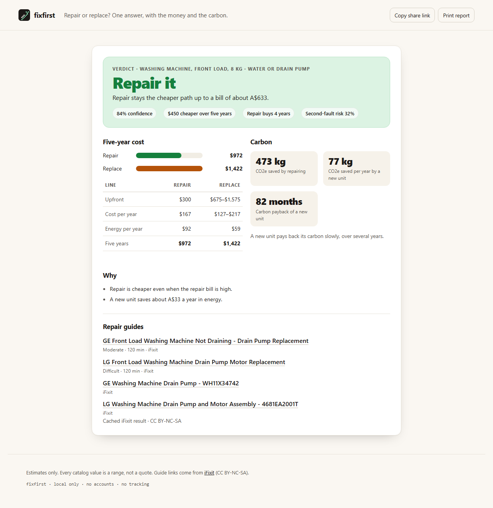
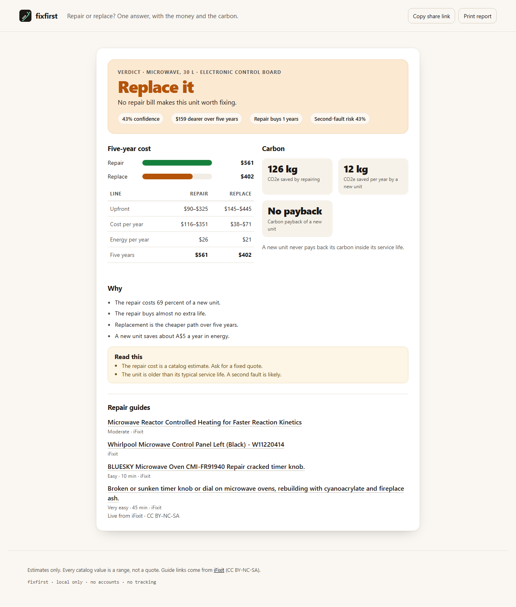
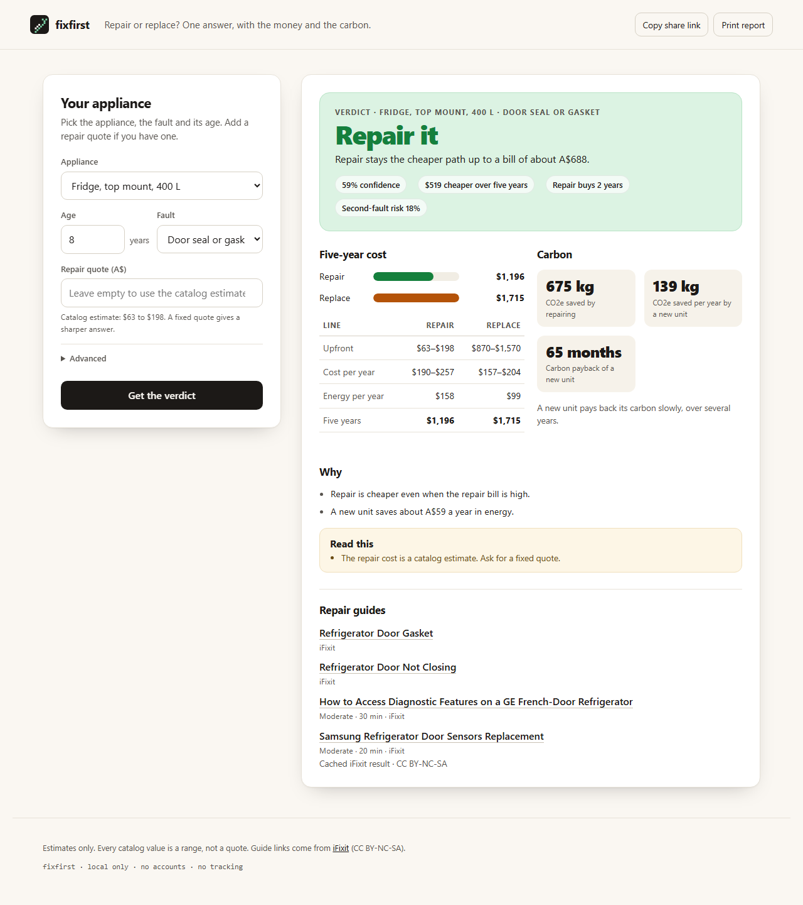

<p align="center"></p>

<h1 align="center">fixfirst</h1>

<p align="center">A repair-or-replace calculator for appliances. It weighs the repair bill and the embodied carbon against a new unit, then gives one verdict.</p>

<p align="center">
  
  
  
  
</p>

A failed dishwasher is a money and carbon decision. Most people replace by habit.
A repair quote takes three phone calls. The carbon sum stays invisible.

fixfirst answers one question: **repair or replace?** It returns a verdict, the
five-year cost of both paths, the carbon saved by repairing, and a repair guide.

## Features

- **32 appliance types and 10 fault classes.** Each entry has a price band, a service life, an embodied-carbon band and an annual energy figure.
- **One verdict, with a confidence score.** The answer is `repair`, `replace` or `borderline`.
- **Honest ranges.** A low and a high value drive the decision. When the range crosses the rule, the tool says so.
- **Five-year cost for both paths.** The repair path includes a second-failure risk and a provision for a later replacement.
- **Carbon arithmetic.** It reports the embodied carbon a repair avoids, the annual emissions a new unit saves, and the payback in months.
- **Break-even quote.** It names the repair bill where the answer flips. Use that number to negotiate.
- **Repair guides from iFixit.** It returns real guides with difficulty and time, cached in SQLite for a week.
- **Share link and print report.** The full input lives in the URL fragment. The report prints on one A4 page.

## Quick start

```bash
git clone https://github.com/fuleinist/fixfirst.git
cd fixfirst
npm start
```

Open <http://localhost:3000>. There is no build step and no runtime dependency.
Node 22.6 or later runs the TypeScript source directly.

Command line:

```bash
node src/cli.ts --appliance dishwasher --age 5 --fault pump --quote 280
node src/cli.ts --list
node src/cli.ts --appliance fridge-top-mount --age 9 --fault seal --json
```

Tests:

```bash
npm test
```

## Screenshots

**A repair verdict, with a real quote.** The old unit stays, and the tool names the bill at which that changes.



**A replace verdict.** The unit is past its service life and the repair costs more than half a new unit.



**The full app.** Pick an appliance, a fault and an age. Add a quote if you have one.



## How the decision works

The model compares two five-year paths.

```
repair  = repair bill x (1 + second-failure risk) + later-replacement provision + old energy
replace = new price - scrap credit + new energy
```

A repair also avoids the embodied carbon of a new unit. A new unit pays that
carbon back only through lower running emissions.

```
carbon payback (months) = embodied carbon of the new unit x 12 / annual emissions saved
```

The range test varies the repair bill and holds the new price at its catalog
midpoint. If the cheap case favours repair and the expensive case favours
replacement, the verdict is `borderline`. That answer is correct: the quote decides.

## Data sources

| Source | Use | Licence |
|--------|-----|---------|
| [iFixit public guides API](https://www.ifixit.com/api/2.0/doc) | Guide title, link, difficulty and time | CC BY-NC-SA |
| [EU EPREL register](https://eprel.ec.europa.eu/) | New-unit energy classes and annual kWh | Free, open |
| [Open Repair Alliance](https://openrepair.org/open-data/) | Fault mix and repair success rates | Open data |
| Australian Energy Rating label | Annual energy of new units | Public |
| Manufacturer spare-part lists | Repair cost bands | Public |

The catalog is a curated snapshot in `src/catalog.ts`. It cites its basis at the
top of the file. Every value is a range, never a single number.

## Limits

- The catalog is a snapshot, not a live price feed. Parts prices vary by country and by month.
- The indoor model is arithmetic, not a measurement. A real quote always wins.
- Guide links depend on the public iFixit API. A failed lookup never blocks a verdict.
- The tool gives no safety or medical advice. A sealed-system repair needs a licensed technician.

## License

MIT. iFixit guide text and images remain CC BY-NC-SA and stay on ifixit.com.